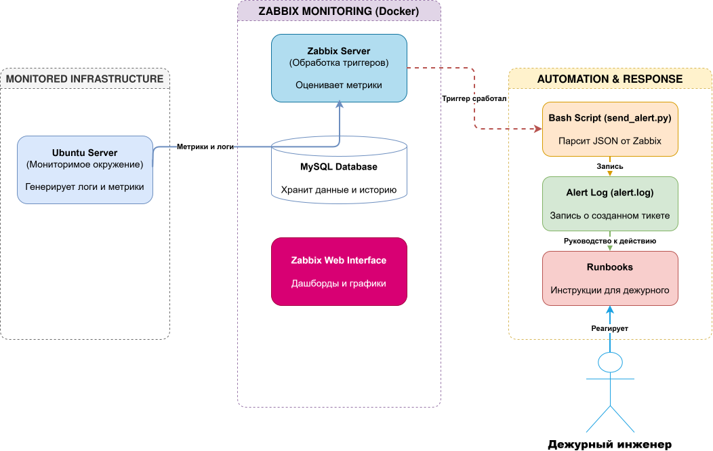

# 🛠️ Duty-Engineer-Toolkit


Учебный проект, демонстрирующий навыки, необходимые инженеру дежурной смены (NOC / SOC L1). Здесь собраны инструменты для мониторинга, автоматизации рутины и база знаний (Runbooks) для быстрого реагирования на инциденты.

## 🗺️ Архитектура проекта



## 🎯 Цель проекта
Показать понимание полного цикла обработки инцидента: от срабатывания алерта в системе мониторинга до создания заявки в ITSM (через скрипт) и устранения проблемы по чек-листу.

## 🚀 Реализованные кейсы

### 1. Развертывание Zabbix и интеграция с ITSM
*   **Что сделано:** Развернут Zabbix Server + MySQL в Docker. Настроен Media Type «Script», который вызывает внешний Bash-скрипт при срабатывании триггера.
*   **Результат:** Скрипт парсит JSON от Zabbix, формирует «тикет» и записывает данные в лог-файл.
*   📂 [Подробнее об интеграции](./zabbix-integration/README.md)

### 2. База знаний (Runbooks)
В папке `runbooks/` собраны пошаговые инструкции для дежурной смены. Это позволяет стандартизировать работу и сократить время реакции (SLA):
*   📄 [Runbook: Высокая загрузка CPU (High CPU)](./runbooks/high_cpu.md)
*   📄 [Runbook: Переполнение диска (Disk Full)](./runbooks/disk_full.md)

### 3. Скрипты автоматизации
В папке `scripts/` лежат инструменты для автоматизации рутины:
*   🐍 [create_ticket.py](./scripts/create_ticket.py) — Python-скрипт для определения приоритета (P1-P4) и формирования payload для ITSM на основе данных от Zabbix.

## 🧠 Решенные проблемы (Troubleshooting)
В процессе настройки пришлось столкнуться и решить несколько классических проблем инфраструктуры:
*   **Несовместимость версий MySQL:** Zabbix отказывался стартовать. Решено добавлением переменной `ZBX_ALLOWUNSUPPORTEDDBVERSIONS=1`.
*   **Отсутствие Python в контейнере:** Официальный образ Zabbix (Alpine Linux) не содержит `python3`. Скрипт был оперативно переписан на Bash.
*   **Права доступа (Permission denied):** Пользователь `zabbix` внутри контейнера не мог писать лог на хост. Права решены настройкой `chmod 777` для учебной среды.

## 📂 Структура репозитория

```text
Duty-Engineer-Toolkit/
├── images/                 # Схемы и скриншоты
├── runbooks/               # Чек-листы для типовых инцидентов
├── scripts/                # Скрипты автоматизации (Python, Bash)
├── zabbix-integration/     # Документация по настройке Zabbix
└── README.md
