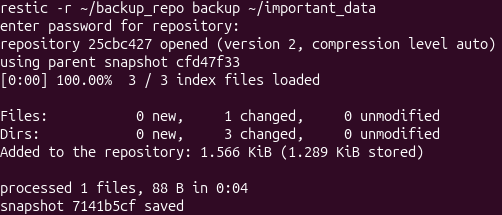
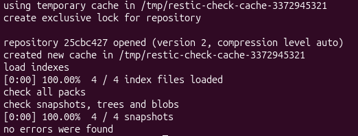

# 💾 Практика резервного копирования (Restic)

## Описание
В рамках лаборатории отработан полный цикл резервного копирования и восстановления данных с использованием утилиты **Restic**.

## Выполненные шаги:
1.  **Инициализация:** `restic init --repo ~/backup_repo` (создано зашифрованное хранилище).
2.  **Полный бэкап (Full):** `restic backup ~/important_data`.
3.  **Инкрементальный бэкап (Incremental):** После изменения данных выполнен повторный `backup`, который скопировал только изменения.
4.  **Восстановление (Restore):** Исходные данные были удалены, а затем успешно восстановлены из последнего снапшота командой `restic restore latest`.
5.  **Проверка целостности:** Выполнена команда `restic check`, которая подтвердила отсутствие ошибок (`no errors were found`).

## Вывод
Инструмент Restic позволяет безопасно хранить зашифрованные копии данных, экономить место благодаря дедупликации и инкрементальному подходу, а также гарантировать целостность резервных копий.
## 📸 Доказательство работы

**1. Создание инкрементального бэкапа:**

**2. Проверка целостности (no errors were found):**

