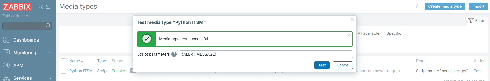
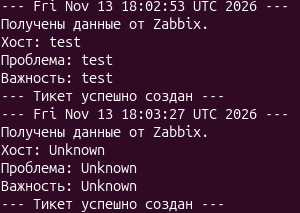

# 🔗 Интеграция Zabbix с ITSM

## 📝 Описание
Настроен полный цикл обработки инцидента: от срабатывания триггера в системе мониторинга Zabbix до вызова внешнего скрипта и создания заявки в ITSM.

## 🛠️ Стек
*   **Мониторинг:** Zabbix Server 8.0 (Docker)
*   **База данных:** MySQL 8.0 (Docker)
*   **Скрипт:** Bash (изначально был Python, но переписан из-за отсутствия интерпретатора в Alpine-образе).

## 🚀 Как это работает
1. Zabbix фиксирует событие (например, переполнение диска).
2. Вызывает скрипт `/usr/lib/zabbix/alertscripts/send_alert.py`.
3. Скрипт парсит JSON, формирует «тикет» и записывает его в файл `alert.log`.

## 🧠 Решенные проблемы (Troubleshooting)
В процессе настройки пришлось столкнуться и решить несколько классических проблем:
*   **Ошибка MySQL:** Zabbix не запускался из-за несовместимости версий. Решено добавлением переменной `ZBX_ALLOWUNSUPPORTEDDBVERSIONS=1`.
*   **Ошибка Python:** В официальном образе Zabbix (Alpine Linux) нет `python3`. Скрипт был переписан на Bash.
*   **Ошибка Permission denied:** Пользователь `zabbix` внутри контейнера не мог писать в лог-файл на хосте. Права решены командой `chmod 777` для учебной среды.

## 📸 Доказательство работы

**1. Успешный тест в веб-интерфейсе Zabbix:**

**2. Результат работы скрипта (файл alert.log):**

